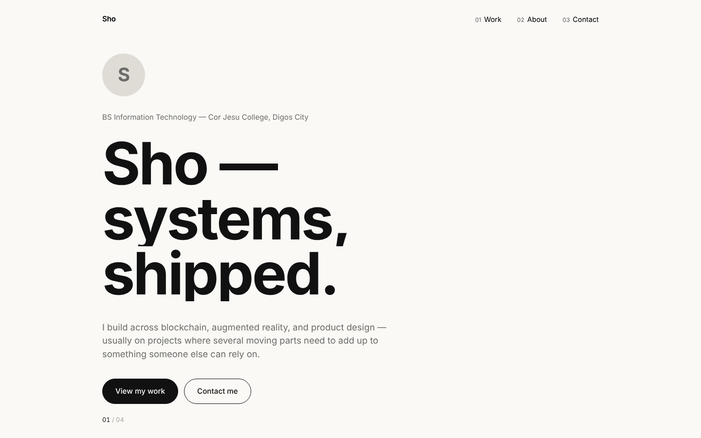

# Portfolio

Personal portfolio for Sho, a BS Information Technology student at Cor Jesu College (Digos City). An editorial "folio" site: a fixed side rail, a big serif hero with a live local-time clock, and chapters that slide to the left as you scroll down (a pinned horizontal scroll). Built with React and GSAP.



## Tech stack

- [React 18](https://react.dev) + [Vite](https://vitejs.dev)
- [React Router 6](https://reactrouter.com) — routes for Home and About, a 404 page, and hash-based section links
- [GSAP](https://gsap.com) + ScrollTrigger — hero entrance, the pinned horizontal scroll, and scroll-linked reveals/parallax. Screens under 900px wide, short screens, and `prefers-reduced-motion` get a normal vertical page.
- Plain CSS with custom properties, mobile-first
- Bodoni Moda (display serif) and Inter Tight (sans) from Google Fonts

## Project structure

```
src/
  components/   Rail (side rail + menu), Hero, Intro, Clock, Projects, ProjectCard, About, Contact, Footer, Portrait, ScrollManager
  lib/          motion.js — shared scroll helpers (section jumping, theme tracking, reveals)
  pages/        Home, About, NotFound
  data/         portfolio.js — all personal content in one file
  index.css     design tokens and all styles
```

## Setup

```bash
git clone <this-repo-url>
cd portfolio
npm install
npm run dev
```

Open the URL Vite prints (usually http://localhost:5173).

```bash
npm run build     # production build into dist/
npm run preview   # serve the production build locally
```

## Customizing

- **Everything** — edit `src/data/portfolio.js`. It holds your details, projects, and About content. Links left empty are hidden automatically.
- **Projects** — each entry takes a title, description, tech list, `image`, `github`, and `demo`.
- **Hero intro, status line, side note** — `site.intro`, `site.status` and `site.aside` in `portfolio.js`.
- **Certificates** — add entries to `certificates` in `portfolio.js` and save the images in `public/certificates/`. They pop in, then play as a slideshow (pause on hover, arrows, thumbnails, click to enlarge).
- **Clock** — set `timezone` in `portfolio.js` to change the city time shown in the hero.
- **Screenshots** — save images in `public/projects/` and set `image: '/projects/your-file.png'`.
- **Photo** — save a portrait as `public/profile.jpg`. An initial is shown until it exists.

## Deployment

The repo includes `vercel.json` and `public/_redirects` so direct visits to any route work on Vercel and Netlify. Import the repository on either platform; the defaults (build command `npm run build`, output directory `dist`) work as-is.
